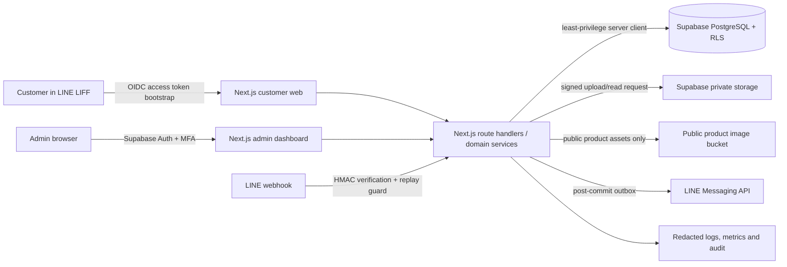
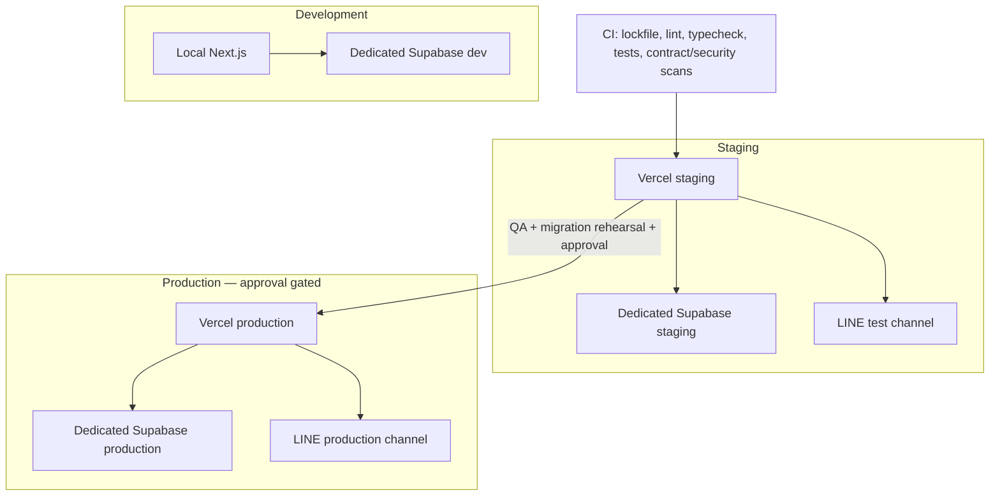

# System Design Baseline

Status: **frozen for Wave 1 mock/schema/security design** (2026-07-13). Any incompatible change requires an A00 change request and contract changelog entry.

## Context and components

The browser never receives a service-role key, LINE secret, raw storage path belonging to another principal, or permanent URL for KYC/slip/condition evidence. The API validates input and authorization before every mutation. Database constraints remain the final concurrency boundary.

## Trust boundaries and data flow

| Boundary | Untrusted input | Required control | Sensitive output |
|---|---|---|---|
| LIFF → session bootstrap | LINE access/ID token | Verify with LINE, issuer/audience/expiry/nonce; bind server session to `sub` | HttpOnly, Secure, SameSite=Lax session cookie |
| Admin browser → API | Cookie, form/body | Supabase Auth session, MFA for privileged mutations, CSRF/origin check, RBAC | Permission-scoped response |
| Browser → upload flow | Name/MIME/size/content | Intent authorization, allowlist, size/count, magic-byte check, randomized object key, quarantine where required | Single-object short-lived signed operation |
| API → database | Derived actor and commands | Transaction, RLS, constraints, optimistic/version guard, audit | Minimum selected columns |
| LINE → webhook | Headers/body | Verify raw-body signature before parse, timestamp/replay/idempotency | 2xx only after durable receipt |
| API → LINE | Outbox event | Send after commit, idempotency key, retry/backoff, redacted observability | Template with minimum PII |

## Deployment

Preview deployments must not use production database, storage, LINE channel, callbacks, or secrets. UTC is the persistence/transport standard; customer-facing rendering uses `Asia/Bangkok`.

## Domain ownership

| Concern | Source of truth | Owner |
|---|---|---|
| API shapes/errors/auth/state names | `docs/contracts/**`, `src/types/**` | A00 |
| Tables/constraints/RLS/database types | `supabase/**`, `src/types/database.generated.ts` | A01 |
| Customer presentation | `src/app/(customer)/**` | A03 |
| Admin presentation | `src/app/admin/**` | A04 |
| LINE/storage/privacy security design | `docs/security/**`, `docs/privacy/**` | A05 |
| Independent test evidence | `docs/testing/**`, `tests/e2e/**` | A06 |
| CI/deployment/operations | `.github/**`, `docs/deployment/**`, `docs/operations/**` | A07 |

## Architectural invariants

1. Prices submitted by clients are advisory; the server recomputes from immutable price snapshots in integer satang.
2. Rental dates are Bangkok calendar dates, inclusive at both ends; transport timestamps remain UTC.
3. Any status mutation is a named command, not a free-form status update.
4. `APPROVED` through `ACTIVE`/return processing hold inventory; database enforcement prevents overlapping holds.
5. KYC, payment slips, condition evidence and contract evidence are private/default-deny.
6. Payment verification, refunds, booking creation and notifications use idempotency keys plus unique persistence.
7. State/audit/contract evidence is append-only; inventory uses soft delete.
8. Verified customer sessions are translated server-side to a ≤5-minute asymmetric database JWT trusted by Supabase; normal requests use the publishable key plus RLS, never the secret/service-role key.
